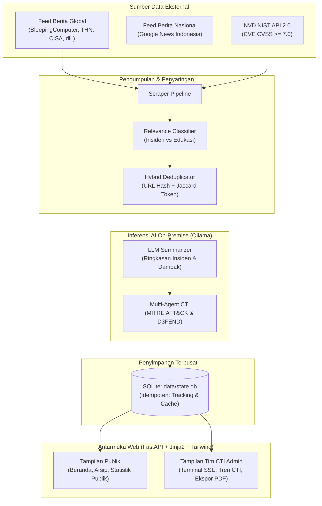

# SiberHarian — Cyber Threat Intelligence & Publikasi Berita/CVE
### Portal Resmi CSIRT Dinas Komunikasi dan Informatika Provinsi Jawa Timur
**Website Integrasi:** [csirt.jatimprov.go.id](https://csirt.jatimprov.go.id/)

---

## 📌 Gambaran Umum

**SiberHarian** adalah platform intelijen ancaman siber (*Cyber Threat Intelligence* / CTI) dan edukasi keamanan siber mandiri berbasis *Local-First Sovereign Intelligence*. Dikembangkan untuk diintegrasikan ke dalam ekosistem portal resmi **CSIRT Provinsi Jawa Timur**, platform ini menjalankan dua peran strategis:

1. **Operasional Internal (Admin Tim CTI CSIRT)**: Menyediakan instrumen pemantauan harian, orkestrasi pengumpulan data otomatis, audit kerentanan software CVE kritis, pemetaan ancaman taktis berbasis kerangka **MITRE ATT&CK & D3FEND**, serta generator **Laporan PDF Resmi Mingguan** untuk briefing pimpinan dan Organisasi Perangkat Daerah (OPD).
2. **Layanan Publik (Masyarakat Umum & Pengelola OPD)**: Menyediakan jendela informasi terkurasi mengenai insiden siber terkini, arsip kerentanan, serta **Tab Statistik Publik** interaktif berbasis 100% fakta empiris untuk meningkatkan literasi dan kewaspadaan siber (*cyber awareness*) masyarakat Jawa Timur.

---

## 👥 Dua Peran Pengguna (*Dual-User Personas*)

| Fitur / Halaman | Pengguna Publik (Masyarakat Umum & Pengelola Web) | Admin Tim CTI (CSIRT Diskominfo Jatim) |
|---|---|---|
| **Tujuan Utama** | Membaca berita siber, memeriksa celah software, literasi pencegahan | Triage insiden harian, audit kerentanan, analisis CTI strategis |
| **Tab 1: Beranda** | **Berita & Statistik**: Wawasan KPI bermakna, Word Cloud kasus insiden spesifik, grafik fakta siber, intisari edukasi asli, dan feed berita hari terakhir | **Dashboard Operasional**: Feed berita/CVE + **Floating Terminal Monitor SSE** (*Run Pipeline*, *Stop*) |
| **Tab 2: Arsip** | Menjelajahi riwayat 7–14 hari dengan filter tanggal dan pencarian instan | Menjelajahi riwayat lengkap dengan audit metadata teknis |
| **Tab 3: Fitur Khusus** | *(Terpadu di Tab Beranda)* | **Tren Siber CTI**: Laporan CTI AI mendalam, matriks mitigasi web, kasus wilayah, & Ekspor PDF Resmi |

---

## 🏗️ Arsitektur Sistem



---

## ✨ Fitur Unggulan

### 1. Kedaulatan Data Penuh (*Local-First Sovereign AI*)
Seluruh pemrosesan teks, klasifikasi, dan ringkasan intelijen dieksekusi secara lokal menggunakan **Ollama** (model *Qwen2.5-Coder / Qwen2.5 / Llama*) di server internal Diskominfo Jawa Timur. Tidak ada transmisi data insiden atau informasi internal ke layanan cloud eksternal pihak ketiga.

### 2. Tab Statistik Publik (Fakta Empiris Tanpa Halusinasi)
Menyajikan data riil yang disederhanakan untuk masyarakat luas:
- **Hero Fact Cards**: Angka riil insiden terpantau, celah software berbahaya, dan total artikel panduan.
- **Top Ancaman Warga**: Visualisasi bar chart jenis kejahatan digital teramai (phishing, pembobolan akun, malware, kebocoran data) yang interaktif (klik batang grafik untuk membaca berita terkait).
- **Software Populer Terpapar**: Informasi aplikasi umum yang sedang memiliki celah keamanan kritis (Microsoft, Google, WordPress, dll.) dengan ajakan untuk rutin melakukan *update*.
- **Pantauan Harian**: Grafik garis fluktuasi insiden untuk menunjukkan bahwa ancaman siber berlangsung setiap hari.
- **Checklist Keamanan Praktis**: Langkah konkret bagi warga untuk mencegah penipuan online dan peretasan akun.

### 3. Tren Siber CTI & Ekspor PDF Resmi (Khusus Tim CTI)
- **Arsitektur SIMP (Sequential Isolated Micro-Prompts)**: Pipeline inferensi Llama 3.2 lokal bertahap yang mengeksekusi modul-modul analitik secara terisolasi tanpa membebani memori CPU/RAM.
- **Taksonomi Standar Nasional & Global**: Standardisasi 10 Sektor Target mengacu pada **Perpres No. 82 Tahun 2022 tentang Infrastruktur Informasi Vital (IIV)** serta 12 taktik **MITRE ATT&CK Enterprise Matrix** untuk analisis vektor serangan yang presisi.
- **Semantic Role Separation Guardrails**: Memisahkan peran entitas secara ketat sehingga perusahaan sekuriti atau peneliti keamanan (Zimperium, Mandiant, Kaspersky, BSSN) tidak pernah keliru dilabeli sebagai penyerang.
- **Ensiklopedia Standar Siber Komprehensif (12 Framework - 165 Entitas)**: Terintegrasi dengan MITRE ATT&CK, MITRE D3FEND, NIST CSF 2.0, OWASP Top 10, CWE, BSSN CSIRT, CIS Controls, Indeks KAMI, CISA CPG, ISO/IEC 27001, CSA CCM, dan CSIRT Framework.
- **Komparatif Mingguan & Kasus Wilayah 3-Kolom**: Analisis lonjakan rolling 7 hari vs baseline, klastering insiden wilayah Jatim vs Nasional vs Global tanpa nilai kosong (-), dan ekspor Laporan PDF Resmi siap cetak.

### 4. Konsol Terminal Pipeline Real-Time (SSE)
Monitor terapung (*floating terminal*) bergaya *Midnight Navy* yang memanfaatkan *Server-Sent Events* (`/api/stream`) untuk mengalirkan status pengumpulan data, deduplikasi, dan ringkasan AI baris demi baris secara transparan.

---

## 💻 Prasyarat Sistem

* **Sistem Operasi**: Linux (Ubuntu 20.04+ direkomendasikan untuk produksi) atau Windows 10/11.
* **Python**: Versi `3.10` atau lebih baru.
* **Ollama**: Terinstal dan berjalan di server lokal (`http://localhost:11434`).
  * Model yang direkomendasikan: `qwen2.5-coder:7b`, `qwen2.5:7b`, atau `llama3.1:8b`.
* **Database**: SQLite3 (bawaan Python, tidak memerlukan instalasi server database eksternal).

---

## 🚀 Panduan Instalasi & Menjalankan

### 1. Kloning Repositori
```bash
git clone https://github.com/Kifansa/SiberHarian.git
cd SiberHarian
```

### 2. Pasang Virtual Environment
```bash
# Membuat virtual environment
python -m venv venv

# Mengaktifkan di Windows (PowerShell):
.\venv\Scripts\Activate.ps1
# Atau di Linux / macOS:
source venv/bin/activate
```

### 3. Pasang Dependensi Python
```bash
pip install -r requirements.txt
```

### 4. Siapkan Model AI Lokal (Ollama)
Pastikan layanan Ollama aktif di latar belakang, lalu unduh model yang digunakan:
```bash
ollama pull qwen2.5-coder:7b
```

### 5. Menjalankan Server Web
Jalankan aplikasi FastAPI menggunakan Uvicorn:
```bash
python -m uvicorn src.web.app:app --host 0.0.0.0 --port 8000 --reload
```
Buka peramban dan akses:
- **Tampilan Utama**: `http://localhost:8000`

### 6. Menjalankan Pipeline Pengumpulan Data Harian
Pipeline dapat dipicu langsung dari tombol **Run** pada terminal antarmuka web, atau dijalankan via terminal CLI/Cron:
```bash
python -m src.pipeline_harian
```

---

## 📁 Struktur Direktori

```
NOTIFIKASI-BERITA/
├── config/
│   └── config.yaml             # Konfigurasi RSS feed, query Google News, NVD API, keyword filter
├── data/
│   ├── state.db                # Database SQLite (konten terkirim, riwayat tren, prediksi CTI)
│   └── encyclopedia/           # 12 Kerangka Kerja Keamanan Siber Resmi (165 entitas JSON)
├── logs/                       # Berkas log pemrosesan harian
├── src/
│   ├── analytics/              # Analisis tren, CTI multi-agent, kalkulasi lonjakan, RAG engine, cti_agents
│   ├── classifier/             # Klasifikasi relevansi artikel siber
│   ├── dedup/                  # Algoritma deduplikasi hybrid (URL hash + text similarity)
│   ├── scraper/                # Pengambil RSS global, Google News, dan API NVD NIST
│   ├── storage/                # Modul koneksi dan query SQLite (db.py)
│   ├── summarizer/             # Peringkas artikel dan CVE menggunakan LLM Ollama
│   ├── utils/                  # Utilitas logger dan parser tanggal
│   ├── web/                    # Backend FastAPI, static assets, dan template Jinja2
│   │   ├── app.py              # Server FastAPI & API endpoint
│   │   ├── static/             # Skrip JS modular, CSS, logo CSIRT
│   │   └── templates/          # index.html dan template parsial (_beranda, _arsip, _tren, _statistik_publik)
│   └── pipeline_harian.py      # Orkestrator alur pengumpulan harian
├── DESIGN.md                   # Spesifikasi sistem desain Sapphire Oceanic
├── PRODUCT.md                  # Definisi produk, visi, dan target pengguna
├── requirements.txt            # Daftar pustaka Python
└── README.md                   # Dokumentasi resmi proyek
```

---

## 📡 Dokumentasi Endpoint API

| Metode | Endpoint | Deskripsi |
|---|---|---|
| `GET` | `/` | Menampilkan antarmuka web SiberHarian |
| `GET` | `/api/beranda` | Mengambil data berita dan CVE terbaru untuk tab Beranda |
| `GET` | `/api/arsip` | Mengambil daftar riwayat 7–14 hari terakhir per tanggal |
| `GET` | `/api/tren` | Mengambil metrik analitik CTI, prediksi AI, dan matriks mitigasi |
| `GET` | `/api/statistik-publik` | Mengambil data agregat fakta siber untuk grafik ramah publik |
| `GET` | `/api/ensiklopedia` | Menelusuri 12 standar keamanan siber resmi (filter kerangka & keyword) |
| `POST` | `/api/run` | Menjalankan pipeline pengumpulan & perangkuman data di thread latar belakang |
| `GET` | `/api/stream` | Server-Sent Events (SSE) log progres pemrosesan real-time |
| `POST` | `/api/cancel` | Membatalkan eksekusi pipeline yang sedang berjalan |

---

## 🎨 Standar Desain Visual

SiberHarian dibangun di atas standar visual **Sapphire Oceanic Edition** yang dirancang khusus untuk memenuhi standar keterbacaan tinggi di Security Operations Center sekaligus ramah untuk warga sipil:
- **Midnight Navy (`#001D39`)**: Warna tipografi tajam berkontras tinggi dan latar belakang konsol log terminal.
- **Dark Sapphire (`#0A4174`)**: Aksen biru berwibawa khas identitas Pemprov Jawa Timur untuk tombol aksi utama.
- **Slate Blue (`#49769F`) & Ice Blue (`#BDD8E9`)**: Hirarki pembagi, status netral, dan border kartu.
- **Tipografi**: Font `Inter` untuk seluruh teks narasi & judul; font `JetBrains Mono` khusus untuk data teknis numerik.

---

## 🏛️ Lisensi & Hak Cipta

Dikembangkan untuk kebutuhan **Dinas Komunikasi dan Informatika Provinsi Jawa Timur** / **CSIRT Jawa Timur** ([csirt.jatimprov.go.id](https://csirt.jatimprov.go.id/)). Seluruh hak cipta dilindungi undang-undang.
