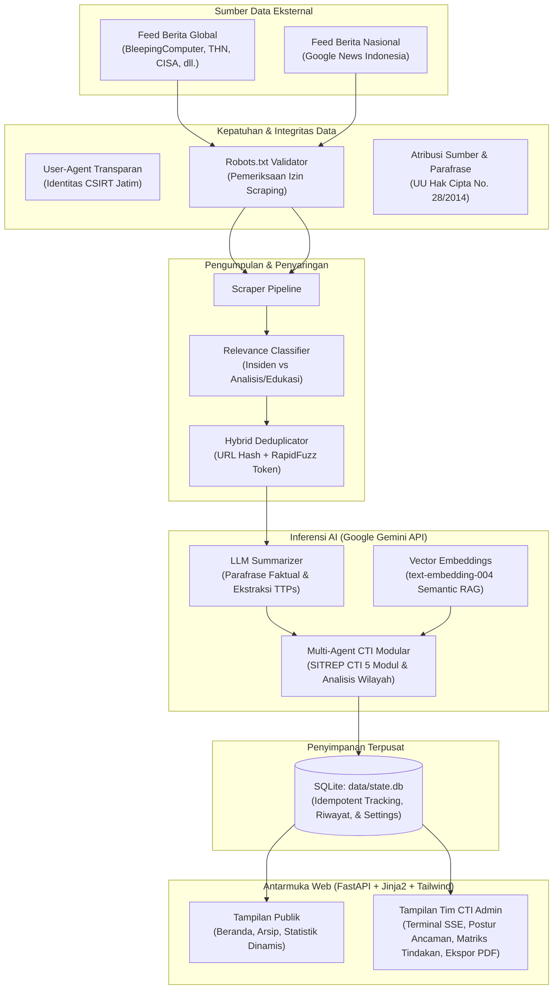

# SiberHarian: Cyber Threat Intelligence & Publikasi Berita Insiden Siber
### Portal Resmi CSIRT Dinas Komunikasi dan Informatika Provinsi Jawa Timur
**Website Integrasi:** [csirt.jatimprov.go.id](https://csirt.jatimprov.go.id/)

---

## 📌 Gambaran Umum

**SiberHarian** adalah platform intelijen ancaman siber (*Cyber Threat Intelligence* / CTI) dan edukasi keamanan siber terpadu berbasis *Cloud-Accelerated Intelligence* dengan Google Gemini API. Dikembangkan untuk diintegrasikan ke dalam ekosistem portal resmi **CSIRT Provinsi Jawa Timur**, platform ini menjalankan dua peran strategis:

1. **Operasional Internal (Admin Tim CTI CSIRT)**: Menyediakan instrumen pemantauan harian, orkestrasi pengumpulan data otomatis, analisis paparan sektor vital (IIV), pemetaan ancaman taktis berbasis kerangka **MITRE ATT&CK & D3FEND**, indeks postur ancaman komparatif, matriks tindakan remediasi, serta generator **Laporan PDF Resmi Mingguan** untuk briefing pimpinan dan Organisasi Perangkat Daerah (OPD).
2. **Layanan Publik (Masyarakat Umum & Pengelola OPD)**: Menyediakan jendela informasi terkurasi mengenai insiden siber terkini, arsip intelijen siber, serta **Tab Statistik Publik** interaktif berbasis 100% fakta empiris untuk meningkatkan literasi dan kewaspadaan siber (*cyber awareness*) masyarakat Jawa Timur.

---

## 👥 Dua Peran Pengguna (*Dual-User Personas*)

| Fitur / Halaman | Pengguna Publik (Masyarakat Umum & Pengelola Web) | Admin Tim CTI (CSIRT Diskominfo Jatim) |
|---|---|---|
| **Tujuan Utama** | Membaca berita siber, memeriksa sektor terpapar, literasi pencegahan | Triage insiden harian, analisis sektor vital IIV, analisis CTI strategis |
| **Tab 1: Beranda** | **Berita & Statistik**: Wawasan KPI dinamis, Word Cloud kasus insiden spesifik, grafik fakta siber, timeline 10 hari, sebaran sumber media, intisari edukasi asli, dan feed berita terkini | **Dashboard Operasional**: Feed berita intelijen + **Floating Terminal Monitor SSE** (*Run Pipeline*, *Stop*) |
| **Tab 2: Arsip** | Menjelajahi riwayat 7 sampai 14 hari dengan filter tanggal dan pencarian instan | Menjelajahi riwayat lengkap dengan audit metadata teknis |
| **Tab 3: Fitur Khusus** | *(Terpadu di Tab Beranda)* | **Tren Siber CTI**: Indeks Postur Ancaman (1.0-10.0), Matriks Tindakan Taktis, Dinamika Deret Waktu 7 Hari, Laporan CTI AI mendalam, kasus wilayah 3 kolom, dan Ekspor PDF Resmi |
| **Tab 4: Pengaturan** | *(Tidak tersedia untuk publik)* | **Panel Pengaturan**: Manajemen sumber RSS, kata kunci pencarian & filter, template prompt LLM, dan konfigurasi Gemini API (khusus Superadmin) |

---

## 🏗️ Arsitektur Sistem



---

## ✨ Fitur Unggulan

### 1. Inferensi AI dengan Google Gemini API & Semantic Vector RAG
Pemrosesan teks, klasifikasi, perangkuman, dan sintesis intelijen ditenagai oleh **Google Gemini API** dengan rantai fallback otomatis:
- **Model LLM:** `gemini-3.1-flash-lite`, `gemini-3.5-flash-lite`, `gemini-3.5-flash`, `gemini-3.6-flash`, dan `gemini-3.7-flash` dengan mekanisme retry otomatis saat menghadapi batasan kuota.
- **Model Vector Embedding:** `text-embedding-004` untuk pencarian semantik (Semantic RAG) dengan fallback mulus ke pencarian leksikal (RapidFuzz).

### 2. Tab Statistik Publik (Fakta Empiris Tanpa Halusinasi)
Menyajikan data riil yang disederhanakan untuk masyarakat luas tanpa generalisasi berlebih:
- **Insightful KPI Cards Dinamis**: Dihitung langsung dari database SQLite (kategori ancaman dominan, sektor sasaran utama IIV, dan persentase isu nasional).
- **Word Cloud Kasus Insiden Riil**: Menampilkan kata kunci kasus insiden teratas yang dapat diklik langsung untuk memfilter feed berita.
- **Sebaran Modus Ancaman Siber**: Grafik batang interaktif kategori kejahatan digital lengkap dengan persentase proporsi kasus.
- **Sebaran Sektor Sasaran Serangan (IIV)**: Distribusi paparan insiden siber pada 10 sektor Infrastruktur Informasi Vital sesuai Perpres No. 82 Tahun 2022.
- **Tren Pantauan Harian & Sebaran Sumber**: Grafik garis pemantauan insiden dan donut chart perbandingan media nasional vs media global / CTI.
- **Intisari Edukasi & Himbauan Keamanan**: Disarikan dari artikel analisis relevan di database untuk panduan pencegahan praktis warga.

### 3. Tren Siber CTI & Ekspor PDF Resmi (Khusus Tim CTI)
- **Indeks Postur Ancaman Siber Komparatif**: Skor risiko terbobot 1.0 sampai 10.0 yang membandingkan 7 hari terkini terhadap 7 hari baseline sebelumnya, lengkap dengan status tren (Meningkat / Stabil / Menurun) dan rekomendasi tindakan pimpinan.
- **Matriks Tindakan Ancaman Aktif**: Tabel tindakan taktis yang mengelompokkan insiden ke dalam kategori ancaman, tingkat urgensi (KRITIS, TINGGI, SEDANG, MONITOR), fokus kerentanan website instansi, serta langkah mitigasi konkret.
- **Dinamika Deret Waktu 7 Hari & Komposisi Sumber**: Grafik deret waktu fluktuasi harian berita insiden serta perbandingan volume ancaman domestik vs internasional.
- **SITREP Modular 5 Bagian**: Terbagi menjadi 5 modul terstruktur (Makro Tren Insiden, Lanskap Mikro & Aktor, Vektor Serangan & MITRE ATT&CK, Rekomendasi Preskriptif D3FEND/NIST deterministik, dan Sinyal Ancaman Baru).
- **Kasus Wilayah 3 Kolom**: Klastering insiden wilayah Jawa Timur, Nasional, dan Global dengan sintesis BLUF (Bottom Line Up Front) dan analisis dampak domino lintas sektor.
- **Laporan PDF Resmi**: Generator dokumen intelijen mingguan berformat standar CSIRT Pemerintah Provinsi Jawa Timur yang siap diunduh dan dicetak.

### 4. Kepatuhan Hukum & Etika Scraping
- **User-Agent Transparan**: Mengirimkan identitas proyek resmi (`News Project (+https://kifansa.my/id; kifansanf@gmail.com)`).
- **Validasi Robots.txt Otomatis**: Memeriksa `robots.txt` setiap domain media sebelum mengambil konten artikel lengkap.
- **Atribusi Hak Cipta & Parafrase**: Menyertakan tautan sumber asli, nama penerbit media, dan disclaimer kepatuhan UU Hak Cipta No. 28/2014 Pasal 43 huruf c.

### 5. Konsol Terminal Pipeline Real-Time (SSE) & Keamanan RBAC
- **Monitor Terminal Mengambang**: Memanfaatkan Server-Sent Events (`/api/stream`) untuk mengalirkan status pengumpulan data, deduplikasi, dan ringkasan AI baris demi baris secara transparan.
- **Manajemen Admin Berbasis Peran (RBAC)**: Mendukung dua tingkat admin: Superadmin (akses penuh termasuk ubah pengaturan dan kunci API) dan Admin Biasa (hanya melihat dashboard dan arsip). Kredensial diamankan dengan hashing bcrypt.

---

## 💻 Prasyarat Sistem

* **Sistem Operasi**: Linux (Ubuntu 20.04+ direkomendasikan untuk produksi) atau Windows 10/11.
* **Python**: Versi `3.10` atau lebih baru.
* **Kunci API Google Gemini**: Diperlukan untuk perangkuman, klasifikasi, dan pembuatan laporan CTI.
* **Database**: SQLite3 (bawaan Python, tidak memerlukan instalasi server database eksternal).

---

## 🚀 Panduan Instalasi & Menjalankan

### 1. Kloning Repositori
```bash
git clone https://github.com/Kifansa/SiberHarian.git
cd SiberHarian
```

### 2. Pasang Virtual Environment
```bash
# Membuat virtual environment
python -m venv venv

# Mengaktifkan di Windows (PowerShell):
.\venv\Scripts\Activate.ps1
# Atau di Linux / macOS:
source venv/bin/activate
```

### 3. Pasang Dependensi Python
```bash
pip install -r requirements.txt
```

### 4. Konfigurasi Kunci API Gemini
Salin berkas contoh konfigurasi lingkungan:
```bash
copy .env.example .env
```
Buka berkas `.env` dan masukkan kunci API Gemini Anda:
```env
GEMINI_API_KEY=AIzaSy...your_gemini_api_key_here
```
Atau Anda dapat mengonfigurasikannya langsung melalui **Panel Pengaturan Admin** setelah login pertama kali.

### 5. Menjalankan Server Web
Jalankan aplikasi FastAPI menggunakan Uvicorn:
```bash
python -m uvicorn src.web.app:app --host 0.0.0.0 --port 8000 --reload
```
Buka peramban dan akses:
- **Portal Publik**: `http://localhost:8000`
- **Login Admin**: `http://localhost:8000/login`

### 6. Menjalankan Pipeline Pengumpulan Data Harian
Pipeline dapat dipicu langsung dari tombol **Run** pada terminal antarmuka admin, atau dijalankan via terminal CLI / Cron:
```bash
python -m src.pipeline_harian
```

---

## 📁 Struktur Direktori

```
NOTIFIKASI-BERITA/
├── config/
│   ├── config.yaml             # Konfigurasi dasar RSS feed, query Google News, dan keyword filter
│   ├── rules/                  # Aturan klasifikasi, pemetaan sektor IIV, dan pemetaan statistik publik
│   └── prompts/                # 6 Template Prompt CTI modular (klasifikasi, ringkas, SITREP)
├── data/
│   ├── state.db                # Database SQLite (riwayat tren, pengguna admin, pengaturan dinamis)
│   └── encyclopedia/           # 12 Kerangka Kerja Keamanan Siber Resmi (165 entitas JSON)
├── logs/                       # Berkas log pemrosesan harian
├── src/
│   ├── analytics/              # Analisis tren, CTI multi-agent, kalkulasi lonjakan, RAG engine, cti_agents
│   ├── classifier/             # Klasifikasi relevansi artikel siber (insiden vs analisis)
│   ├── dedup/                  # Algoritma deduplikasi hybrid (URL hash + text similarity)
│   ├── scraper/                # Pengambil RSS global, Google News, dan robots.txt checker
│   ├── storage/                # Modul koneksi dan query SQLite (db.py)
│   ├── summarizer/             # Peringkas artikel intelijen siber menggunakan Google Gemini API
│   ├── utils/                  # Utilitas adapter LLM, settings manager, HTTP client, logger
│   ├── web/                    # Backend FastAPI, static assets, dan template Jinja2
│   │   ├── app.py              # Server FastAPI, rute auth, & API endpoint
│   │   ├── static/             # Skrip JS modular, stylesheet, logo CSIRT
│   │   └── templates/          # index.html, admin.html, login.html, dan template parsial
│   └── pipeline_harian.py      # Orkestrator alur pengumpulan harian
├── CHANGELOG.md                # Catatan rilis dan evolusi arsitektur
├── DESIGN.md                   # Spesifikasi sistem desain Sapphire Oceanic
├── PRODUCT.md                  # Definisi produk, visi, dan target pengguna
├── requirements.txt            # Daftar pustaka Python
├── .env.example                # Template konfigurasi variabel lingkungan
└── README.md                   # Dokumentasi resmi proyek
```

---

## 📡 Dokumentasi Endpoint API

| Metode | Endpoint | Akses | Deskripsi |
|---|---|---|---|
| `GET` | `/` | Publik | Halaman utama portal publik SiberHarian |
| `GET` | `/login` | Publik | Halaman login admin CSIRT |
| `POST` | `/api/login` | Publik | Otentikasi admin (mengembalikan token sesi) |
| `POST` | `/api/logout` | Admin | Keluar dari sesi admin |
| `GET` | `/admin` | Admin | Dashboard operasional dan analitik Tim CTI CSIRT |
| `GET` | `/api/beranda` | Publik | Mengambil data berita intelijen siber terbaru untuk tab Beranda |
| `GET` | `/api/arsip` | Publik | Mengambil daftar riwayat 7 sampai 14 hari terakhir per tanggal |
| `GET` | `/api/tren` | Admin | Mengambil metrik analitik CTI, postur ancaman, matriks tindakan, dan prediksi AI |
| `GET` | `/api/statistik-publik` | Publik | Mengambil data agregat fakta siber untuk grafik ramah publik |
| `GET` | `/api/ensiklopedia` | Publik | Menelusuri 12 standar keamanan siber resmi (filter kerangka & keyword) |
| `POST` | `/api/run` | Admin | Menjalankan pipeline pengumpulan data di latar belakang |
| `GET` | `/api/stream` | Admin | Server-Sent Events (SSE) log progres pemrosesan real-time |
| `POST` | `/api/cancel` | Admin | Membatalkan eksekusi pipeline yang sedang berjalan |
| `GET` | `/api/settings` | Admin | Mengambil pengaturan dinamis sistem (RSS, keyword, prompts) |
| `POST` | `/api/settings` | Superadmin | Memperbarui pengaturan sistem di database |

---

## 🎨 Standar Desain Visual

SiberHarian dibangun di atas standar visual **Sapphire Oceanic Edition** yang dirancang khusus untuk memenuhi standar keterbacaan tinggi di Security Operations Center sekaligus ramah untuk warga sipil:
- **Midnight Navy (`#001D39`)**: Warna tipografi tajam berkontras tinggi dan latar belakang konsol log terminal.
- **Dark Sapphire (`#0A4174`)**: Aksen biru berwibawa khas identitas Pemprov Jawa Timur untuk tombol aksi utama.
- **Slate Blue (`#49769F`) & Ice Blue (`#BDD8E9`)**: Hirarki pembagi, status netral, dan border kartu.
- **Tipografi**: Font `Inter` untuk seluruh teks narasi & judul; font `JetBrains Mono` khusus untuk data teknis numerik.

---

## 🏛️ Lisensi & Hak Cipta

Dikembangkan untuk kebutuhan **Dinas Komunikasi dan Informatika Provinsi Jawa Timur** / **CSIRT Jawa Timur** ([csirt.jatimprov.go.id](https://csirt.jatimprov.go.id/)). Seluruh hak cipta dilindungi undang-undang.
